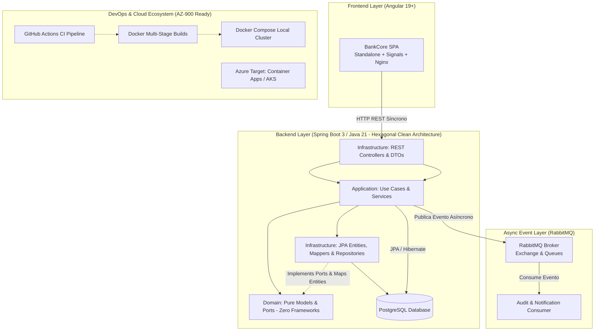
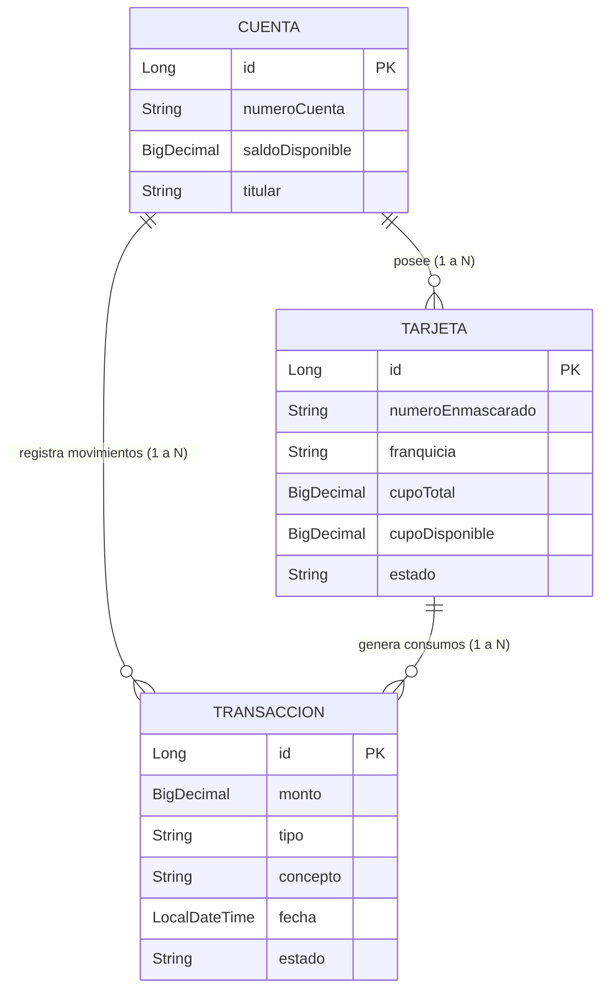

# 🚀 PLAN DE ACCIÓN & TRACKING: CERTIFICACIÓN TÉCNICA COE (FULLSTACK & DEVOPS)

> **Candidato:** Consultor de Desarrollo  
> **Evaluador:** Centro de Excelencia (CoE) de Arquitectura y Desarrollo  
> **Fecha de Evaluación:** Miércoles 14 de Octubre de 2026 ⋅ 9:00 AM – 10:00 AM (COT)  
> **Proyecto Insignia:** **BankCore Digital** (Fullstack Cloud-Native & Event-Driven)  
> **Estado General:** 🟨 En Ejecución Intensiva (5 Días para la Valoración)  
> **Última Actualización:** 2026-10-08  

---

## 📌 Leyenda de Estados
- 🟩 **`[x]` Completado:** Código implementado, funcionando y dominado para explicar en la llamada.
- 🟨 **`[/]` En Curso:** Tema actual en desarrollo, explicación o refactorización.
- ⬜ **`[ ]` Pendiente:** Siguiente paso programado en la ruta de aceleración.

---

## 🏛️ Arquitectura Global del Proyecto a Defender

Este es el mapa mental exacto que proyectarás y explicarás con naturalidad ante los evaluadores:

---

## 📅 RUTA INTENSIVA DÍA A DÍA (8 AL 13 DE OCTUBRE)

---

### ☕ DÍA 1: Cimientos del Backend con Java 21 & Spring Boot 3
*Objetivo: Construir la API REST de BankCore aplicando Clean Architecture Hexagonal Estricta (Ports & Adapters), DTOs con Records, persistencia JPA desacoplada mediante Mappers, transacciones ACID e Idempotencia Financiera.*

> **🏛️ Topología Oficial Hexagonal de BankCore (Inviolable):**
> - **`domain/` (Núcleo Puro - Cero Frameworks):**
>   - `model/`: Entidades de dominio puras (`Cuenta`, `Tarjeta`, `Transaccion`) con lógica de negocio rica.
>   - `enums/`: Tipos restringidos (`EstadoCuenta`, `TipoMovimiento`).
>   - `port/`: Contratos e interfaces de salida (`CuentaRepositoryPort`, etc.).
> - **`service/` (Casos de Uso / Capa de Aplicación):**
>   - Orquestación de reglas bancarias llamando exclusivamente a los puertos de dominio.
> - **`infrastructure/` (Detalles Técnicos & Adaptadores Externos):**
>   - `persistence/entity/`: Entidades JPA de base de datos (`CuentaJpaEntity`, `TarjetaJpaEntity`, `TransaccionJpaEntity`).
>   - `persistence/repository/`: Repositorios Spring Data JPA (`SpringDataCuentaRepository`, etc.).
>   - `persistence/mapper/`: Mappers bidireccionales (`CuentaPersistenceMapper`: JPA <-> Dominio Puro).
>   - `persistence/adapter/`: Implementación de los puertos (`CuentaRepositoryAdapter` implementa `CuentaRepositoryPort`).
>   - `rest/controller/`: Controladores HTTP REST (`CuentaController`, etc.).
>   - `rest/dto/`: Contratos de red inmutables con Records (`TransferenciaRequestDto`, etc.).
>   - `rest/mapper/`: Mappers de presentación (`CuentaRestMapper`: Dominio Puro <-> DTO).
>   - `config/`: Configuraciones de Spring, CORS, OpenAPI.

- [x] **1.1 Setup de Infraestructura con Gradle:**
  - Configuración de `settings.gradle` y `build.gradle` con Java 21 LTS y Spring Boot 3.3.4.
  - Entendimiento de los 4 alcances de dependencias: `implementation`, `runtimeOnly`, `compileOnly`, `testImplementation`.
- [x] **1.2 Clean Architecture Hexagonal & Diseño de Paquetes:**
  - Creación física y separación estricta de responsabilidades: `domain/` (puro), `service/`, `infrastructure/persistence/`, `infrastructure/rest/`.
  - Aplicación de **SRP (Single Responsibility Principle)** e Inversión de Dependencias (DIP) a nivel de capas.
- [x] **1.3 Inyección de Dependencias Quirúrgica & SOLID (DIP):**
  - Análisis técnico: por qué la inyección por atributo `@Autowired` es un antipatrón prohibido (oculta dependencias y rompe tests unitarios).
  - Implementación de inyección por constructor con campos inmutables `private final` (o `@RequiredArgsConstructor` de Lombok).
- [x] **1.4 Contratos Inmutables con Java 21 Records (DTO Pattern):**
  - Creación de DTOs de entrada y salida en `infrastructure.rest.dto`: `TransferenciaRequestDto`, `TransferenciaResponseDto`, `CuentaResponseDto`.
  - Por qué los `records` reemplazan clases mutables con getters/setters y protegen la integridad de memoria.
- [x] **1.5 Validación Defensiva de Entradas (Jakarta Validation):**
  - Anotaciones declarativas en DTOs: `@NotNull`, `@Positive`, `@NotBlank`.
  - Patrón *Fail-Fast*: rechazar peticiones maliciosas (ej. montos negativos) en la puerta de enlace (`HTTP 400 Bad Request`).
- [x] **1.6 Desacoplamiento de Persistencia: Entidades JPA & Mappers Bidireccionales:**
  - Creación de modelos de dominio puros en `domain.model` (`Cuenta`, `Tarjeta`, `Transaccion`) libres de anotaciones de Hibernate.
  - Mapeo de tablas SQL en `infrastructure.persistence.entity` (`CuentaJpaEntity`, `TarjetaJpaEntity`, `TransaccionJpaEntity`).
  - Creación de Mappers en `infrastructure.persistence.mapper` (`CuentaPersistenceMapper`, etc.) para traducir entre el Dominio Puro y la Base de Datos.
- [x] **1.7 Puertos de Dominio & Adaptadores de Persistencia (Ports & Adapters):**
  - Definición de interfaces en `domain.port` (`CuentaRepositoryPort`, etc.).
  - Implementación del adaptador `CuentaRepositoryAdapter` usando `SpringDataCuentaRepository`.
- [x] **1.8 Relaciones Relacionales & Prevención del Antipatrón N+1:**
  - Relación `@ManyToOne` entre `TarjetaJpaEntity` $\rightarrow$ `CuentaJpaEntity` y `TransaccionJpaEntity` $\rightarrow$ `CuentaJpaEntity`.
  - Por qué la carga perezosa (`FetchType.LAZY`) es obligatoria en banca para evitar consultas SQL explosivas.
- [x] **1.9 Lógica Bancaria y Transaccionalidad ACID en Servicios:**
  - Creación de `CuentaService` y `RealizarTransferenciaUseCase` (Patrón Command / Use Case).
  - Aplicación de `@Transactional(rollbackFor = Exception.class)` para garantizar atomicidad estricta en el débito y crédito.
- [x] **1.10 Patrón de Idempotencia Financiera en Código Real:**
  - Creación de `IdempotenciaService` y entidad de control `RegistroIdempotenciaJpaEntity`.
  - Manejo genérico con Jackson (`ObjectMapper`) y prevención de doble débito ante reintentos de red.
- [x] **1.11 Controladores RESTful & Semántica HTTP:**
  - `CuentaController`, `TarjetaController` y `TransferenciaController` con `@RestController` y `@RequestMapping`.
  - Endpoints: `GET /api/v1/cuentas/{id}`, `GET /api/v1/cuentas/{id}/movimientos`, `GET /api/v1/cuentas/{id}/tarjetas`, `PUT /api/v1/tarjetas/{id}/bloquear`, `POST /api/v1/transferencias`.
  - Respuestas HTTP correctas (`200 OK`, `201 Created`, `400 Bad Request`, `404 Not Found`).
- [x] **1.12 Manejo Centralizado de Excepciones (RFC 7807):**
  - Creación de `GlobalExceptionHandler` con `@RestControllerAdvice` y `@ExceptionHandler`.
  - Captura de `"Saldo no disponible"` devolviendo el estándar bancario `ProblemDetail` (RFC 7807) sin fugar trazas internas (`StackTraces`).
- [x] **1.13 Documentación Viva con Swagger / OpenAPI:**
  - Configuración de `springdoc-openapi` y verificación visual de endpoints en `http://localhost:8080/swagger-ui.html`.
- [x] **1.14 🎙️ Simulacro CoE Día 1:**
  - Batería de 3 preguntas de entrevista resueltas en 20 segundos (*Inyección por constructor, DTOs vs Entidades, Idempotencia*).
- [x] **1.15 Blindaje de Calidad, Gobernanza & DevSecOps (JaCoCo, ArchUnit, PITest, SonarCloud):**
  - Pruebas de integración BDD modulares (`CuentaIntegrationTest`, `TransferenciaIntegrationTest`, `TarjetaIntegrationTest`) con aislamiento transaccional y semántica *Given-When-Then*.
  - **ArchUnit (Fitness Functions):** 5 reglas que auditan la pureza del dominio Hexagonal, DIP en servicios y prohibición de `@Autowired` por campo.
  - **JaCoCo:** **100% de Cobertura en todas las métricas** (1,478/1,478 instrucciones, 106/106 ramas, 372/372 líneas, 98/98 métodos, 23/23 clases) con bytecode Lombok excluido (`lombok.config`).
  - **PITest (Mutation Testing):** **100% Mutation Score** (88/88 mutantes aniquilados, 0 mutantes sobrevivientes en `domain.model`, `service`, y `service.usecase`).
  - **SonarCloud:** Integración completa en CI de GitHub Actions, **100% de cobertura en 372 líneas**, **0.0% duplicaciones**, **Rating A en Seguridad y Mantenibilidad**, y resolución del Blocker Bug de proxy bypass Spring AOP (`java:S2229`).

---

### 🐰 DÍA 2: Asincronía Financiera & Event-Driven con RabbitMQ
*Objetivo: Implementar mensajería asíncrona real desacoplando la transacción bancaria de la auditoría y configurando Dead Letter Queue (DLQ) en código.*

- [x] **2.1 Paradigma Event-Driven en Finanzas:**
  - Análisis arquitectónico: por qué una transferencia bancaria jamás debe bloquearse esperando el envío de correos o análisis de fraude.
- [x] **2.2 Configuración del Broker Spring AMQP:**
  - Definición programática en `RabbitMQConfig.java`: Topic Exchange (`bank.events`), Dead Letter Exchange (`bank.dlx`), Cola Principal (`transacciones.audit.queue`), DLQ (`transacciones.audit.dlq`) y serializador JSON con Jackson.
- [x] **2.3 El Productor de Eventos (Event Publisher):**
  - Creación del evento inmutable de dominio `TransaccionRealizadaEvent` (Record puro) y puerto `TransaccionEventPublisherPort`.
  - Publicación resiliente en `RabbitTransaccionEventPublisher` tras el commit transaccional atómico de la transferencia.
- [x] **2.4 El Consumidor Resiliente & Auditoría Forense SARLAFT/AML (Hexagonal):**
  - Implementación de modelo de dominio puro `RegistroAuditoria` y puerto desacoplado `AuditoriaRepositoryPort`.
  - Adaptador secundario `RegistroAuditoriaRepositoryAdapter` con entidad JPA `RegistroAuditoriaJpaEntity`, mapper y repositorio en `registros_auditoria`.
  - Capa de aplicación `AuditoriaService` con regla de riesgo SARLAFT (montos >= $5,000,000 COP clasificados como `ALERTA_AML_REVISION`, inferiores como `BAJO_RIESGO_CONFORME`).
  - Listener en `AuditoriaTransaccionConsumer` delegando a `AuditoriaService` de forma asíncrona tras recibir eventos de RabbitMQ.
- [x] **2.5 Resiliencia con Dead Letter Queue (DLQ en Código Real):**
  - Configuración de argumentos `x-dead-letter-exchange` y `x-dead-letter-routing-key`.
  - Disparador controlado (`AmqpRejectAndDontRequeueException`) ante `SIMULAR_ERROR_AUDITORIA` y monitoreo en `AuditoriaDlqConsumer`.
- [x] **2.6 Ingeniería de Rendimiento & Estrés con Grafana k6 (DevOps / SRE):**
  - Creación del script `k6/load-test.js` con ráfagas concurrentes de hasta 100 VUs, thresholds p(95) < 400ms y validación de idempotencia UUID.
  - **Resultados Certificados de Carga:** **15,980 transacciones procesadas a 532.5 TPS**, **0.00% tasa de fallo (0 errores)**, latencia **p(95) de 80.62ms** (superando con holgura el SLA de < 400ms) y verificación visual de drenaje en RabbitMQ Management UI.
- [x] **2.7 🎙️ Simulacro CoE Día 2:**
  - Batería de 2 preguntas de entrevista resueltas en 20 segundos (*Justificación EDA, Libro Mayor vs Auditoría AML, y arquitectura de una Dead Letter Queue*).

---

### 🔗 DÍA 3: Integración Fullstack (Angular ↔ Spring Boot) & Estrategia de Testing
*Objetivo: Conectar el frontend existente con el backend real aplicando los Módulos 2, 3, 4 y 5 de Angular con pruebas automatizadas.*

- [x] **3.1 Consumo HTTP Reactivo en Angular (Módulo 2 Angular):**
  - Configuración de CORS en Spring Boot (`@CrossOrigin` en `WebConfig`).
  - Uso de `provideHttpClient(withFetch())` y consumo de endpoints REST en `CuentasService`.
- [x] **3.2 Puente Reactivo RxJS a Signals (Módulo 2 Angular):**
  - Transformación reactiva de observables a señales con `toSignal()` para vincular datos vivos a los componentes con zero memory leaks.
- [ ] **3.3 Formularios Reactivos Bancarios (Módulo 3 Angular):**
  - Formulario de transferencias con `ReactiveFormsModule` y `FormGroup` fuertemente tipado.
  - Validaciones síncronas (`Validators.required`, `Validators.min(1)`) y reactividad en tiempo real.
- [ ] **3.4 Interceptor HTTP de Seguridad e Idempotencia (Módulo 4 Angular):**
  - Creación de un interceptor funcional con `HttpInterceptorFn` para adjuntar el header bancario `Idempotency-Key` (UUID) en cada transacción.
- [ ] **3.5 Optimización de Rendimiento con OnPush (Módulo 5 Angular):**
  - Aplicación de `ChangeDetectionStrategy.OnPush` en componentes de movimientos y tarjetas.
- [ ] **3.6 Pruebas Unitarias en Frontend (Módulo 5 Angular):**
  - Pruebas unitarias de componentes con `TestBed` y Jasmine validando emisión de eventos (`output`) y renderizado.
- [ ] **3.7 Pruebas Unitarias en Backend con JUnit 5 & Mockito (Módulo 6 Java):**
  - Prueba unitaria de lógica de negocio en `TransferenciaService` aislando los repositorios con `@Mock` y `@InjectMocks`.
- [ ] **3.8 Pruebas de Capa Web Backend con MockMvc (Módulo 6 Java):**
  - Prueba de integración de API con **MockMvc** validando que el endpoint devuelva `HTTP 200` y el JSON esperado.
- [ ] **3.9 🎙️ Simulacro CoE Día 3:**
  - Batería de preguntas de entrevista resueltas en 20 segundos (*Pirámide de pruebas, OnPush y Mockito vs MockMvc*).

---

### 🐳 DÍA 4: Contenerización Docker & Seguridad Bancaria Frontend (Módulo 6 Angular + DevOps)
*Objetivo: Empaquetar todo el sistema con Docker, aplicar seguridad web defensiva y demostrar afinidad natural con Azure (AZ-900).*

- [ ] **4.1 Multi-Stage Dockerfile para Angular (Build + Runtime):**
  - Stage 1: Build de producción optimizado con Node.js (`npm run build`).
  - Stage 2: Imagen ultra-ligera con Nginx sirviendo los estáticos compilados y gestionando rutas SPA (`try_files $uri $uri/ /index.html`).
- [ ] **4.2 Endurecimiento de Seguridad Web en Nginx (Módulo 6 Angular):**
  - Archivo `nginx.conf` con cabeceras bancarias estrictas: `Content-Security-Policy` (CSP), `X-Frame-Options: DENY`, `X-Content-Type-Options: nosniff`.
  - Explicación de mitigación contra ataques XSS, Clickjacking y MIME sniffing.
- [ ] **4.3 Multi-Stage Dockerfile para Spring Boot (Módulo 7 Java):**
  - Stage 1: Compilación del artefacto con Gradle (`./gradlew bootJar`).
  - Stage 2: Runtime ligero con Eclipse Temurin JRE 21 Alpine sin usuario root (`USER appuser`) por estándares de ciberseguridad.
- [ ] **4.4 Orquestación Multicontenedor con `docker-compose.yml`:**
  - Definición de 4 servicios: `postgres`, `rabbitmq`, `bankcore-backend`, `bankcore-frontend`.
  - Configuración de redes internas de Docker (`bank-network`), volúmenes persistentes y variables de entorno seguras.
- [ ] **4.5 El Puente DevOps / Azure (AZ-900):**
  - Cómo mapear este proyecto a la nube de Azure:
    - Angular $\rightarrow$ *Azure Static Web Apps* o *Container Apps*.
    - Spring Boot $\rightarrow$ *Azure Container Apps* o *App Service*.
    - RabbitMQ $\rightarrow$ *Azure Service Bus* (o RabbitMQ en clúster).
    - Base de Datos $\rightarrow$ *Azure Database for PostgreSQL Flexible Server*.
- [ ] **4.6 🎙️ Simulacro CoE Día 4:**
  - Batería de preguntas de entrevista resueltas en 20 segundos (*Multi-stage builds, CSP y arquitectura en Azure*).

---

### ⚙️ DÍA 5: CI/CD con GitHub Actions & Documentación Ejecutiva
*Objetivo: Automatizar la integración continua y preparar el repositorio para proyectarlo con orgullo en la sesión grabada.*

- [ ] **5.1 Versionamiento Profesional (Git Flow & Conventional Commits):**
  - Commits limpios y estructurados: `feat:`, `fix:`, `refactor:`, `test:`, `ci:`.
- [ ] **5.2 Pipeline de CI en GitHub Actions:**
  - Creación de `.github/workflows/ci.yml`.
  - Pasos automáticos: Lint de Angular $\rightarrow$ Tests de Frontend $\rightarrow$ Build de Angular $\rightarrow$ Tests de Spring Boot $\rightarrow$ Build del JAR con Gradle.
- [ ] **5.3 README.md de Nivel Arquitectónico:**
  - Diagrama de arquitectura visible.
  - Decisiones de diseño justificadas (ADR - Architectural Decision Records).
  - Guía de inicio rápido con un solo comando: `docker compose up --build`.
  - Instrucciones para ejecutar la prueba de estrés de **Grafana k6**.
- [ ] **5.4 🎙️ Simulacro CoE Día 5:**
  - Batería de preguntas de entrevista resueltas en 20 segundos (*Calidad continua y prevención de regresiones en CI*).

---

### 🎙️ DÍA 6: El Gran Ensayo General (Simulacro CoE de 60 Minutos)
*Objetivo: Dominar la narrativa, el tono y las respuestas exactas de la valoración para asegurar un dictamen positivo.*

- [ ] **6.1 El Pitch de Apertura (2 minutos):**
  - Cómo presentarte: quién eres, qué construiste en BankCore y por qué tiene arquitectura empresarial.
- [ ] **6.2 Defensa de los 5 Pilares del CoE:**
  - **Cómo diseñas:** Clean Architecture, SOLID, desacoplamiento Dumb/Smart y broker de mensajería.
  - **Cómo pruebas:** Pruebas unitarias de componentes y servicios; pruebas de integración con MockMvc; pruebas de estrés con k6.
  - **Cómo integras:** APIs REST síncronas para consultas, RabbitMQ para eventos asíncronos y Docker Compose para el entorno local.
  - **Cómo versionas:** Git con Conventional Commits y ramas protegidas.
  - **Cómo usas la IA:** La IA como acelerador y copiloto de refactor, pero con total control humano sobre las decisiones técnicas.
- [ ] **6.3 Demostración en Vivo Fluida (Las 6 Ventanas del Arsenal):**
  1. Frontend Angular (:4200) operando con Signals.
  2. Swagger UI (:8080/swagger-ui.html) documentando contratos REST y RFC 7807.
  3. Panel de RabbitMQ (:15672) mostrando exchanges, colas y la DLQ.
  4. Terminal ejecutando la prueba de carga masiva con **Grafana k6**.
  5. Docker Desktop mostrando los 4 contenedores operando en verde.
  6. GitHub Actions mostrando el pipeline de CI completado exitosamente.
- [ ] **6.4 Estrategia de Transición hacia DevOps:**
  - Cómo expresar tu interés genuino por DevOps/Cloud presentando tu certificación **AZ-900**, tus pruebas de k6 y la base de Docker/CI que ya dominas.

---

## 📊 Matriz de Competencias a Demostrar ante el CoE

| Pilar del CoE | Lo que ellos evalúan | Lo que demostraremos con BankCore |
| :--- | :--- | :--- |
| **Diseño** | ¿Copia código o sabe estructurar soluciones? | Clean Architecture, Inmutabilidad, SRP, Signals, Records, RabbitMQ, Idempotencia. |
| **Pruebas** | ¿Sabe probar o solo prueba manual en navegador? | Tests unitarios con Jasmine/Jest (Frontend), JUnit 5/Mockito (Backend) y MockMvc. |
| **Rendimiento / SRE** | ¿El sistema colapsa ante alta demanda? | **Pruebas de estrés con Grafana k6** disparando miles de peticiones concurrentes y monitoreo en RabbitMQ. |
| **Integración** | ¿Entiende cómo se comunican los sistemas? | REST JSON síncrono + RabbitMQ asíncrono con Dead Letter Queue (DLQ) para resiliencia. |
| **Versionamiento** | ¿Sabe trabajar en equipo y con estándares? | Git estructurado, Conventional Commits y CI con GitHub Actions. |
| **Uso de IA** | ¿Es un copipegador pasivo o un ingeniero aumentado? | Capacidad de justificar cada línea, cada patrón y cada tecnología elegida. |
| **Aspiración DevOps** | ¿Tiene potencial para proyectos Cloud? | Multi-stage Dockerfiles, Docker Compose, CI, k6 y certificación AZ-900. |

---

## 📝 Bitácora de Sesiones de Batalla

| Fecha | Día / Fase | Hitos Técnicos Logrados | Estado |
| :--- | :--- | :--- | :--- |
| *08-Oct-2026* | Planificación | Creación del Roadmap Estratégico CoE y alineación de prioridades. | 🟩 Completado |
| *09-Oct-2026* | Día 1 & 2 | Backend Spring Boot 3 + REST + RabbitMQ Asíncrono. | ⬜ Pendiente |
| *10-Oct-2026* | Día 3 | Integración Angular ↔ Spring Boot + Testing Frontend/Backend. | ⬜ Pendiente |
| *11-Oct-2026* | Día 4 | AZ-900 + Dockerización Fullstack + Docker Compose. | ⬜ Pendiente |
| *12-Oct-2026* | Día 5 | GitHub Actions CI + README Ejecutivo CoE. | ⬜ Pendiente |
| *13-Oct-2026* | Día 6 | Simulacro Técnico 1-a-1 de 60 minutos (Ensayo General). | ⬜ Pendiente |
| *14-Oct-2026* | **Día D** | **Valoración Oficial Centro de Excelencia (9:00 AM COT).** | 🏆 Meta Final |
